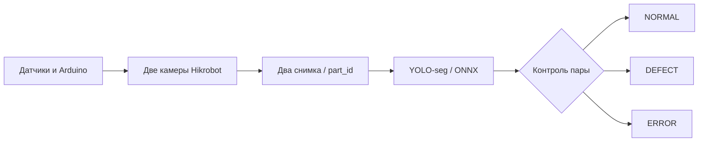
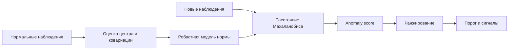
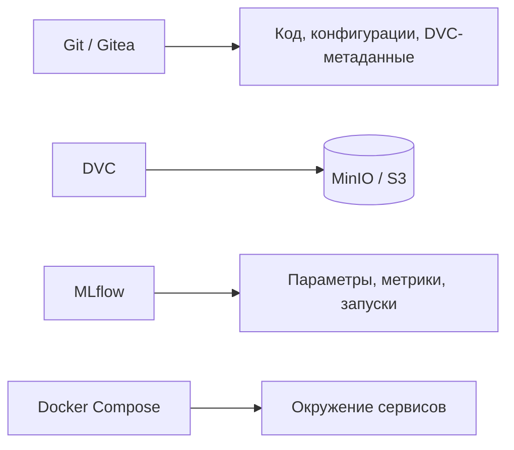

  

# Александр Хаслиенко

### ML-engineer · System Design · MLOps · Computer Vision · Edge AI   

Разрабатываю ML-системы от подготовки данных и инференса до интеграции с оборудованием и управления артефактами.

---

## Обо мне

Я ML-инженер с практическим опытом в компьютерном зрении, обнаружении аномалий и построении инфраструктуры для командной ML-разработки. Работаю не только с моделями, но и с окружением, в котором они используются: Linux, Docker, GPU-инференс, промышленные камеры, встраиваемые устройства и системы хранения данных.

Для меня важны воспроизводимость экспериментов, понятная логика принятия решений и возможность проверить результат на реальных данных, а не только в ноутбуке.

## Проекты

### 01 · AI Stamping — визуальный контроль качества деталей на конвейере

**Задача.** Автоматизировать контроль металлических деталей: получить изображения с двух ракурсов, обнаружить дефекты поверхности и выдать одно решение по каждой детали для дальнейшей сортировки.

**Как устроена система.** Две промышленные камеры **Hikrobot** последовательно снимают одну деталь. Сигналы датчиков и управление движением конвейера обрабатывает **Arduino Mega 2560**. Снимки связываются с идентификатором детали (`part_id`), чтобы результаты разных камер не смешивались. Вычислительная часть ориентирована на **NVIDIA Jetson Orin**.

На стороне ML используется **YOLO-сегментация** с тремя типами дефектов: `chip` (скол), `unpolished` (неполированная область) и `termo` (термический дефект). Для инференса модель экспортируется в **ONNX**; обработка изображений выполняется в Python. Результаты двух кадров объединяются в одно решение: дефект на любом снимке приводит к статусу `DEFECT`, отсутствие необходимого кадра или ошибка обработки — к `ERROR`, отсутствие выявленных дефектов при корректной паре — к `NORMAL` с учётом правил контроля сторон детали.

**Схема обработки:**

**Что сделано в программном пилоте:** загрузка конфигурации, ONNX-инференс пары изображений, оркестрация обработки, сохранение исходных и размеченных кадров, формирование `result.json`, интерфейс оператора и отправка управляющих команд по Serial. Отдельно прорабатываются синхронизация съёмки, управление подачей следующей детали и передача решения сортировщику.

**Статус:** программный пилот реализован; интеграция с реальным конвейером и оборудованием — в разработке.

**Стек:** Python · Ultralytics YOLO · OpenCV · ONNX Runtime · Docker · NVIDIA Jetson · Hikrobot · Arduino / Serial

### 02 · Anti-Fraud — ранжирование подозрительных событий без учителя

**Задача.** Построить систему, которая выделяет нетипичные наблюдения из потока данных и **ранжирует их по степени аномальности**. Основная сложность — сильный **дисбаланс классов**: нормальных наблюдений существенно больше, чем аномальных. При таких условиях обучение обычного бинарного классификатора может быть ограничено количеством и репрезентативностью примеров редких событий.

**Подход.** Вместо обучения на двух классах используется **one-class / unsupervised anomaly detection**: модель изучает структуру нормального поведения, а затем оценивает, насколько новое наблюдение от неё отклоняется. В основе скоринга — **робастное расстояние Махаланобиса**, которое учитывает не только величину отклонений отдельных признаков, но и взаимосвязи между ними. Для повышения устойчивости применяются предварительная обработка признаков и регуляризация оценки ковариации.

**Как работает пайплайн.** Данные проходят подготовку и преобразование признаков → вычисляется числовой **anomaly score** → наблюдения сортируются по убыванию подозрительности. Отдельный этап превращает скоринг в сигналы: калибровка порогов, агрегация результатов во временных окнах и постобработка помогают уменьшить количество кратковременных ложных срабатываний. Таким образом, ранжирование и окончательное решение о сигнале разделены — порог можно настраивать под требования к ложным тревогам.

**Схема скоринга:**

**Проверка качества.** Для обучения используются нормальные наблюдения; размеченные аномальные случаи нужны для независимой проверки и подбора порогов, а не для обучения двухклассовой модели. В проекте предусмотрена валидация с разделением по сессиям (**LOSO**), чтобы снизить риск утечки между обучением и проверкой. Рассматриваются **FPR, полнота обнаружения, PR-AUC и задержка обнаружения** — при редких событиях одной accuracy недостаточно.

**Стек и методы:** Python · NumPy · Pandas · scikit-learn · Robust Mahalanobis · One-Class Learning · обработка временных рядов · сессионная валидация

> Описание ограничено общими принципами алгоритма: прикладная область, исходные данные и детали внедрения не публикуются.

### 03 · MLOps Infrastructure — инфраструктура разработки и хранения ML-артефактов

**Задача.** Организовать совместную работу над ML-проектами так, чтобы код, датасеты, веса моделей и эксперименты не смешивались в одном репозитории, а нужное состояние проекта можно было восстановить.

**Организация хранения.** **Git / Gitea** используются для исходного кода, конфигураций, истории изменений и работы с ветками. Крупные датасеты и веса моделей версионируются через **DVC**; сами файлы размещаются в S3-совместимом **MinIO**, а Git хранит ссылки на их версии. Это позволяет не загружать тяжёлые бинарные файлы непосредственно в историю Git и связывать изменения кода с соответствующими данными.

**Разделение ответственности сервисов:**

**Эксперименты и окружение.** Для фиксации запусков, параметров и метрик используется **MLflow**. Сервисы разворачиваются через **Docker Compose**; в инфраструктуре применяются **PostgreSQL**, Linux и локальная сеть, в том числе для рабочих мест без прямого доступа к интернету. Такая архитектура разделяет задачи Git, объектного хранилища и трекинга экспериментов, вместо попытки решить их одним инструментом.

**Практический результат:** организована серверная инфраструктура для командной ML-разработки и хранения версионируемых артефактов. Развитие автоматизированных пайплайнов и единых командных правил — отдельная текущая задача; полноценную CI/CD-платформу здесь не заявляю.

**Стек:** Git · Gitea · DVC · MinIO (S3) · MLflow · Docker Compose · PostgreSQL · Ubuntu

## Технологии

| Направление | Инструменты |
| :--- | :--- |
| **Язык и анализ данных** | Python, NumPy, Pandas, Matplotlib, Jupyter |
| **ML / CV** | PyTorch, scikit-learn, Ultralytics YOLO, OpenCV |
| **Инференс** | ONNX Runtime, NVIDIA CUDA, NVIDIA Jetson |
| **MLOps** | Git, GitHub, Gitea, DVC, MLflow, MinIO (S3) |
| **Инфраструктура** | Docker, Docker Compose, Linux / Ubuntu, WSL2, PostgreSQL |
| **Локальные AI-инструменты** | Ollama, Open WebUI, MCP |
| **Разработка и интеграция** | VS Code, промышленные камеры Hikrobot, Arduino, Serial |

---

*От данных и математической модели — к воспроизводимому инференсу и реальной системе.*

